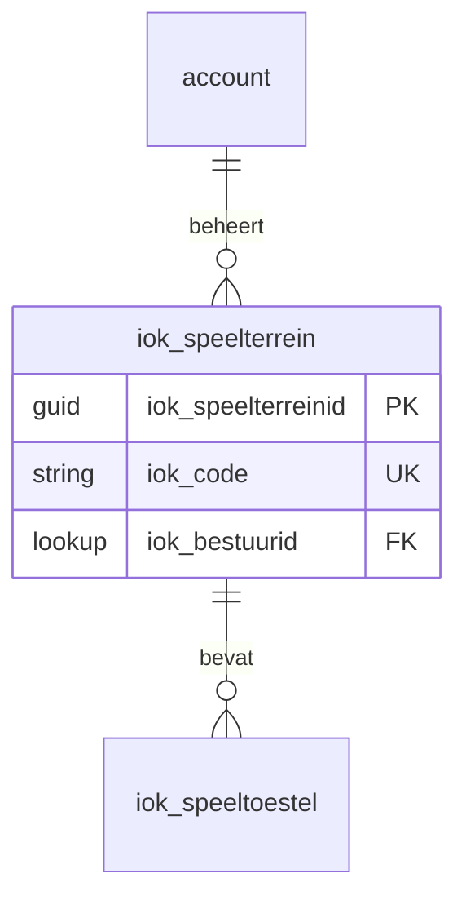

# ERD in Mermaid

**Uitvoer:** `03_output/ERD_v3.md` (en eventueel deeldiagrammen per groep).
Alleen tekenen als Dries dat expliciet vraagt (AGENTS.md: "nog niet tekenen").

## Regels
- Gebruik de **schemanamen** als entiteitsnamen (`account`, `iok_speelterrein`). Standaardtabellen zonder prefix, eigen tabellen met `iok_`.
- Toon per tabel: primaire sleutel (`PK`), alternatieve sleutel (`UK`), lookups (`FK`) en enkel de belangrijkste kolommen. Volledige kolomlijst hoort in `datamodel_v3.md`, niet in het diagram.
- Kardinaliteit: `||--o{` voor 1:N, `}o--o{` voor native N:N. Label = korte werkwoordsvorm in het Nederlands.
- Groepeer met commentaar (`%% Stamgegevens`) in de volgorde: stamgegevens → sjablonen → inspectie → communicatie.
- Meer dan ±20 tabellen? Maak een overzichtsdiagram (alleen tabellen + relaties) en deeldiagrammen per groep.

Bekijken: VS Code (Markdown Preview Mermaid Support) of mermaid.live.

## Naar draw.io
Als de MCP-server **drawio** aan staat: open het Mermaid-diagram in draw.io en bewaar het als `03_output/IOK_erd_v3.drawio`, zodat v2 en v3 in hetzelfde formaat naast elkaar staan. Gebruik voor de tabellen dezelfde notatie als v2 (PK/FK-kolom, naam: type), maar met Dataverse-schemanamen en -types.
