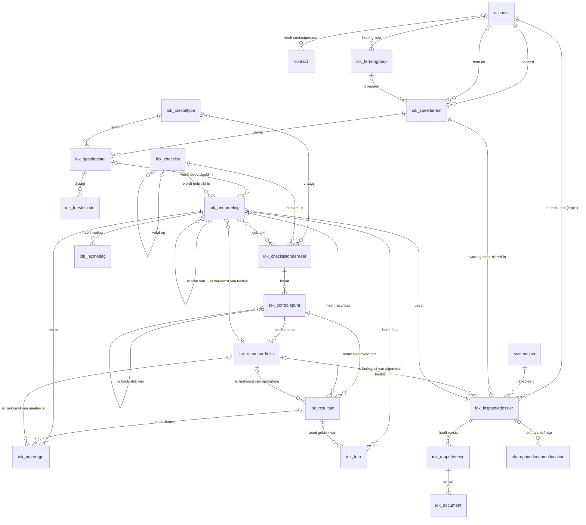
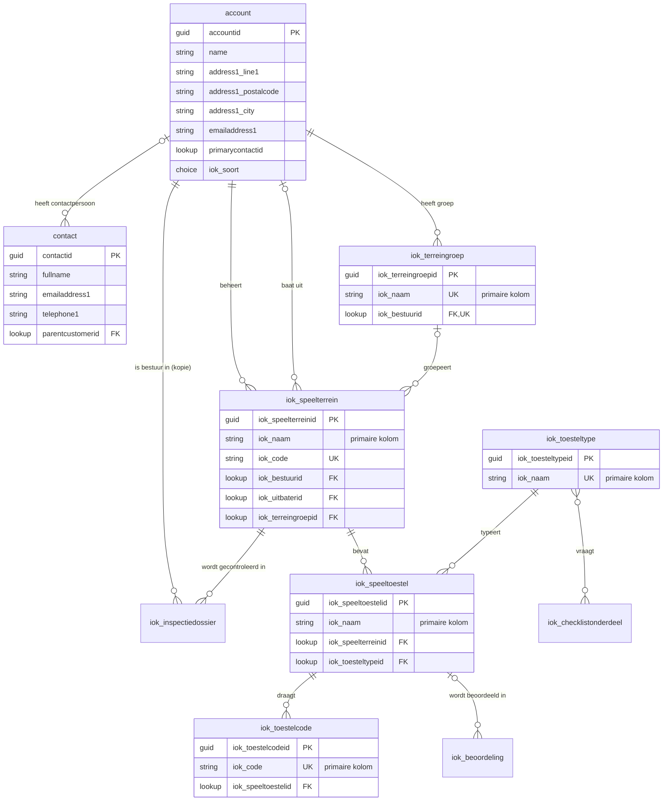
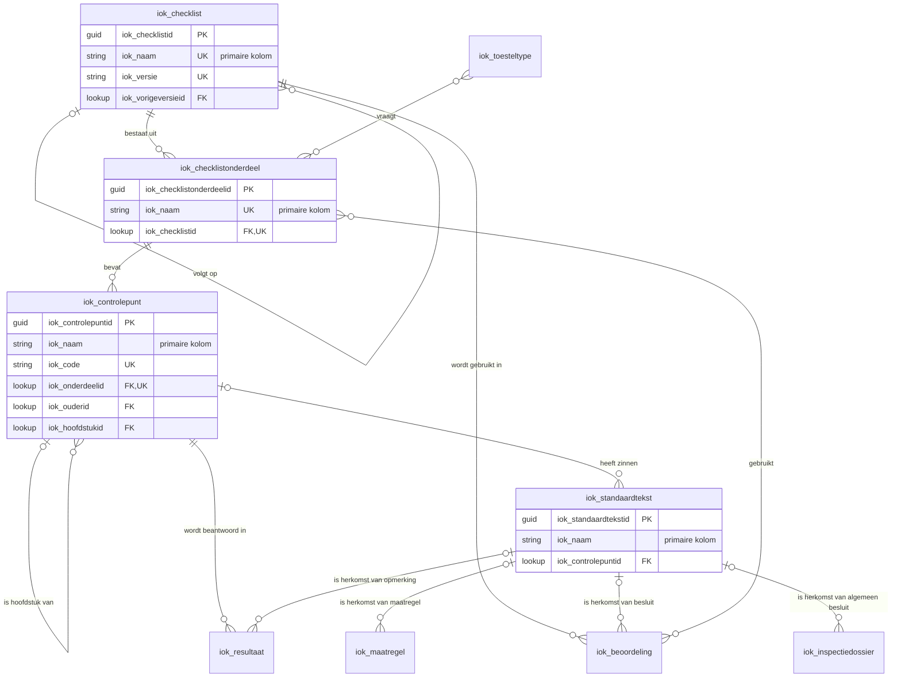
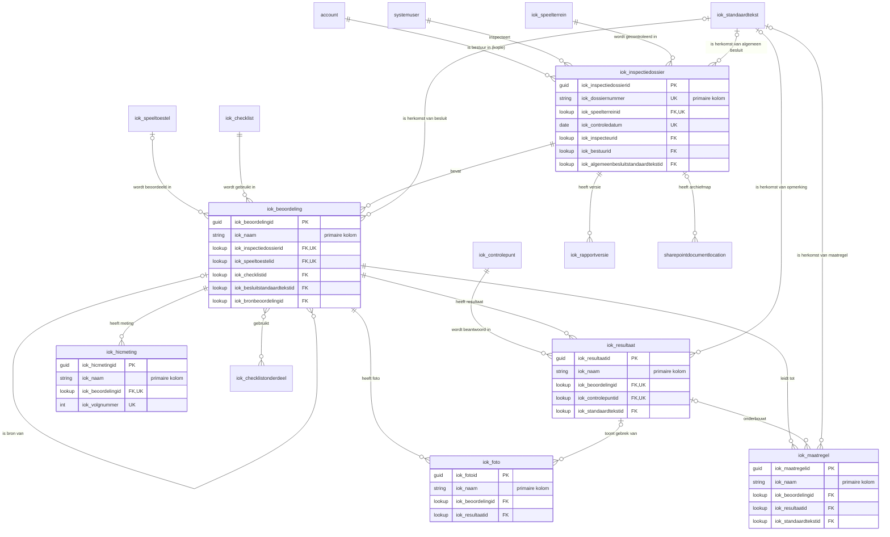
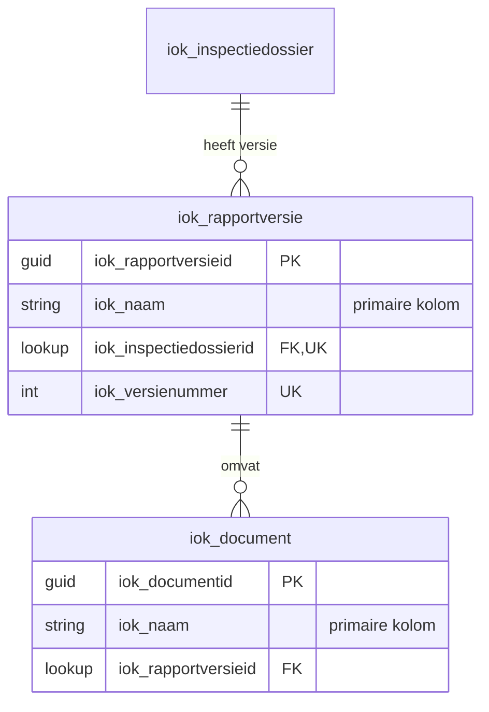

# ERD datamodel v3 – IOK

_Gegenereerd uit `03_output/datamodel_v3.md` door `tools/stap6_genereer.py` (stap 6). Niet met de hand wijzigen._

21 tabellen (4 standaard, 17 eigen), 35 relaties 1:N en 2 native N:N. Volledige kolomlijsten staan in `datamodel_v3.md`; de diagrammen tonen de sleutel (PK), alternatieve sleutels (UK), lookups (FK) en de primaire kolom. Hetzelfde model met alle kolommen: `IOK_erd_v3.drawio`.

Notatie: `||--o{` = verplichte lookup (1 : 0..N), `|o--o{` = optionele lookup (0..1 : 0..N), `}o--o{` = native N:N. Bekijken: VS Code (Markdown Preview Mermaid Support) of mermaid.live.

## 1. Overzicht (alle tabellen en relaties)

## 2. Stamgegevens

Tabellen van deze groep met hun sleutels en lookups; tabellen uit andere groepen staan er enkel als naam bij.

## 3. Sjablonen

Tabellen van deze groep met hun sleutels en lookups; tabellen uit andere groepen staan er enkel als naam bij.

## 4. Inspectie

Tabellen van deze groep met hun sleutels en lookups; tabellen uit andere groepen staan er enkel als naam bij.

## 5. Communicatie

Tabellen van deze groep met hun sleutels en lookups; tabellen uit andere groepen staan er enkel als naam bij.

## 6. Platform

`systemuser` en `sharepointdocumentlocation` zijn standaardtabellen zonder eigen kolommen; ze staan in het overzicht en in de groepen Inspectie en Communicatie.
